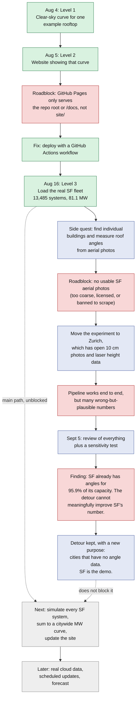
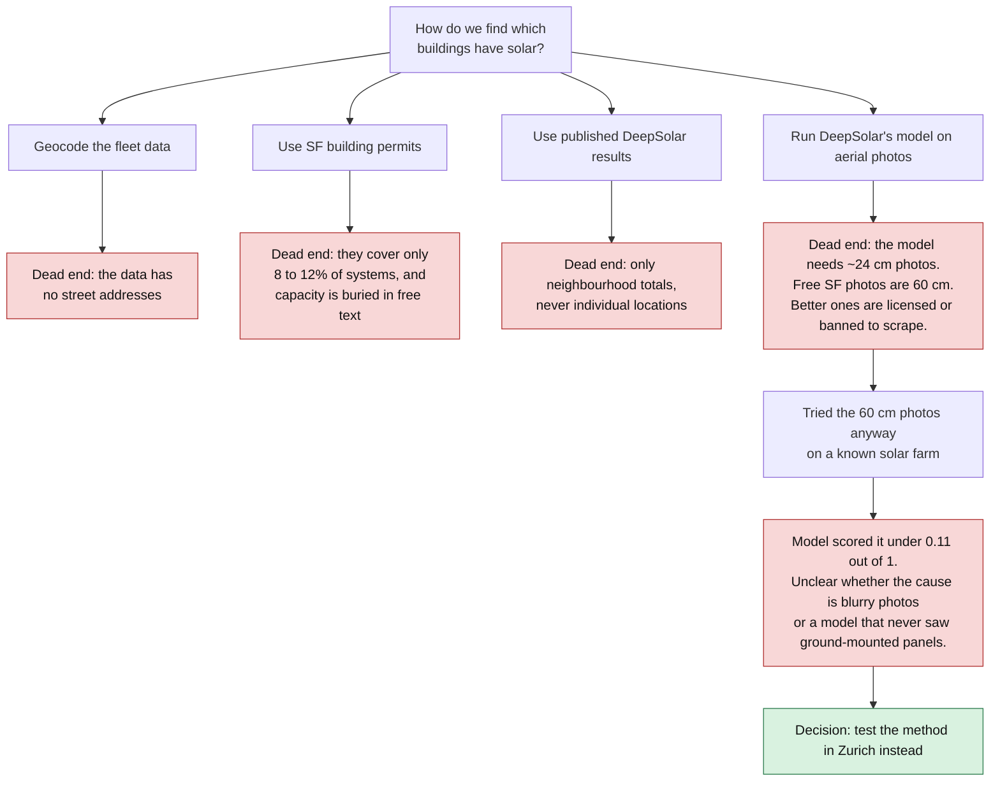
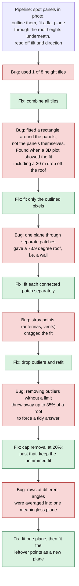
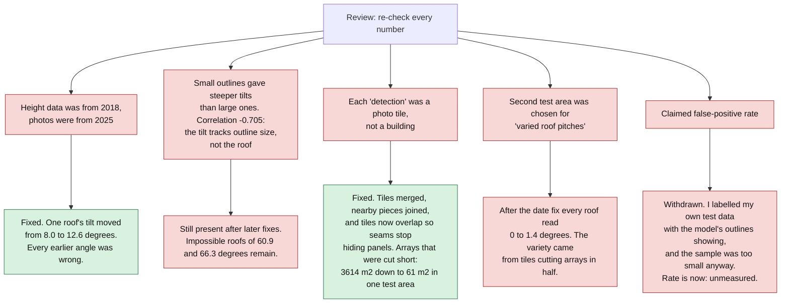
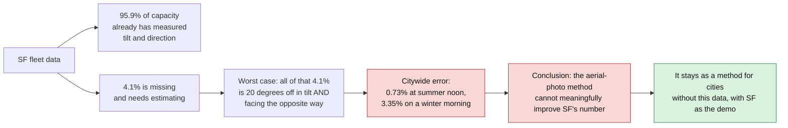

# SF Solar

Goal: estimate how much electricity San Francisco's rooftop solar is producing right now, and show it on a website.

Live site: https://hammerly-energy.github.io/sf-solar/ (right now it shows one example rooftop, not the city).

Method: take every solar system in the city, work out how much sun hits each one, reduce that for clouds, and add it up.

This README records what happened, in order, including the parts that failed. Detailed notes are in [`CLAUDE.md`](CLAUDE.md) and [`docs/`](docs/). Technical terms are explained in the [glossary](#glossary) at the bottom.

---

## The whole project in one picture

Green = worked. Red = roadblock. Grey = not started.



---

## Roadblock 1: finding individual buildings in San Francisco

The fleet data only says which ZIP code a system is in. I wanted exact buildings and roof angles, so I tried four ways to get them.



---

## Roadblock 2: the Zurich pipeline kept giving believable wrong answers

Zurich publishes free aerial photos and free laser-scanned height maps, so the method could be tested there. It worked, but nothing crashed when it was wrong. Each bug below produced a normal-looking number and was found only by drawing a picture.



Two checks that found nothing: I tested whether the photos and height maps were misaligned (no consistent shift) and whether shrinking the photos blurred away the panels (no effect on scores). Both are ruled out.

---

## Roadblock 3: the September 5 review

I went back through the whole detour and tried to break it. Several earlier claims did not survive.



One false positive is documented: the model's most confident Wiedikon detection (0.95 out of 1) is four skylights, while two clearly real arrays scored 0.35 and 0.26.

---

## The result that changed the plan

I ran fake errors through the full SF fleet. Question: if the roof angles for some systems were wrong, how wrong would the citywide total be?



Two further results from the same test:

- Errors that all lean the same way hurt far more than random errors that cancel out. A 20-degree tilt bias changes winter 9 am output by 48.6%. The same amount as random scatter changes it by 13.2%. The photo method's error is the leaning kind.
- 30 MW of flat systems store "direction = 0" as a placeholder, not as "facing north". Treating it as north would overstate every error.

---

## Where things stand

| Piece | Status |
|---|---|
| One-rooftop curve and website | Done, live |
| SF fleet loaded, cleaned, mapped by ZIP | Done |
| Simulate every SF system and sum to a citywide curve | **Not done. Next.** |
| Update the website to show the citywide curve | Not done |
| Cloud data, scheduled updates (`data/latest.json`), forecast | Not started |
| Zurich photo pipeline | Works on two test areas. Error rates unmeasured. Tilt numbers biased for small arrays. |

Known open problems in the photo pipeline:

- Missed panels (false negatives) have never been counted, and for a citywide total they are the error that matters most.
- The panel outlines cover only strips of some large real arrays.
- The function that produces tilt and direction has no automated test.
- A denser laser point cloud (about 7 times more points) is available and unused.

---

## Rules adopted along the way

These came from specific mistakes:

- **Plot every physics change** and check it against a known range. Most bugs here only showed in a picture.
- **Never set a threshold using a known wrong example.** Doing so gives a number that cannot fail. This happened once and was redone.
- **Keep known false positives out of the work that measures rows.** Mixing the two questions ("where are the rows?" and "is this solar at all?") produced two wrong conclusions in one session.
- **No automatic commits.** They made the history hard to follow.
- **One thing per session turn.**

---

## Glossary

- **Clear-sky output:** electricity a system would make with no clouds.
- **MW / kW:** power. kWh is energy, which is power over time.
- **Nameplate / DC / AC:** nameplate is the rated size of the panels (DC). The inverter converts to AC and caps what reaches the grid, so peak AC is about 70 to 85% of nameplate.
- **Tilt:** roof angle from flat. **Azimuth:** compass direction the panels face (180 = south).
- **LiDAR / height map (DSM):** laser scan giving the height of everything seen from above, including roofs and rooftop equipment.
- **Plane fit:** finding the flat surface that best matches a set of height points.
- **Outlier:** a point that doesn't belong to the surface, such as an antenna.
- **Segmentation:** outlining which pixels of a photo are panels.
- **Classifier:** the model that says whether a photo tile contains solar. Scores run 0 to 1.
- **False positive / false negative:** reported solar that isn't there / solar that is there but was missed.
- **Correlation (ρ):** how closely two measurements move together, from -1 to 1. Here, -0.705 between outline size and tilt means the two are tied together when they should not be.
- **Sensitivity test:** deliberately adding errors to the inputs and watching how much the output moves.

---

## Running it

SF fleet and the error test:

```bash
uv run python scripts/level3_fleet.py
```

```bash
uv run python scripts/level3_geometry_sensitivity.py
```

Geometry tests, which run in seconds:

```bash
uv run --isolated --with numpy --with scipy --with rasterio python scripts/test_roof_geometry.py
```

Zurich photo pipeline (needs about 1.2 GB of model weights in `data/raw/deepsolar_weights/`; use `altstetten` instead of `zurich` for the second area):

```bash
uv run --isolated --with "torch>=2.3" --with transformers==4.46.3 --with rasterio \
  --with pystac-client --with planetary-computer --with matplotlib --with requests --with scipy \
  python scripts/level3_cv_detection.py zurich
```

## Layout

```
sf-solar/
├── CLAUDE.md       working rules and detailed findings
├── docs/           original roadmap and architecture
├── scripts/        fleet loading, simulation checks, Zurich pipeline, tests
├── data/           outputs (data/raw is not committed)
└── site/           the website
```

## Data sources

- California DG Stats, Interconnected Project Sites
- SWISSIMAGE, swissSURFACE3D, swissALTI3D, ©swisstopo
- DeepSolar-3M model
- pvlib-python for solar physics
